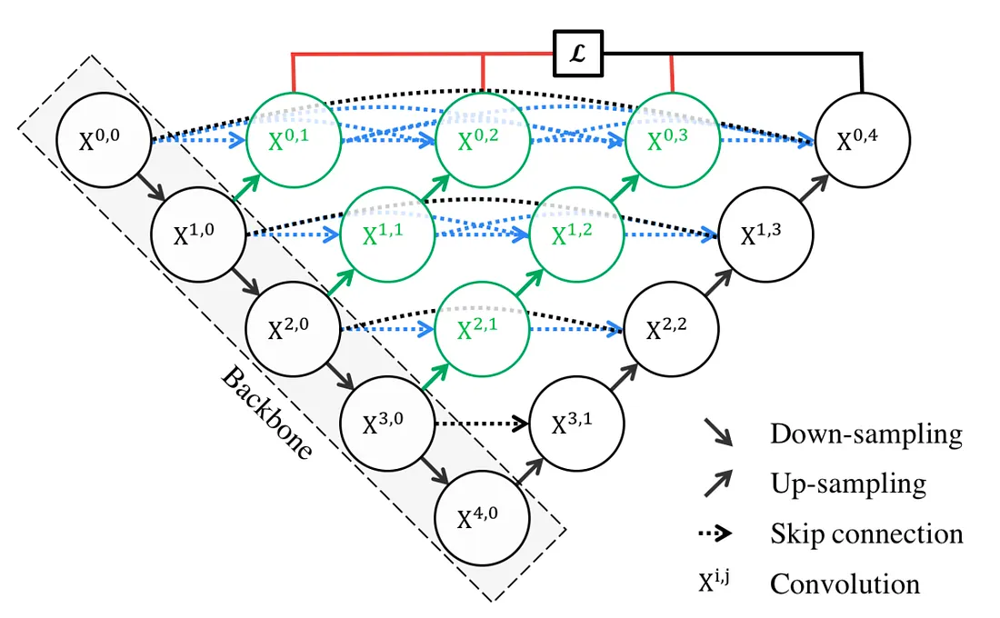
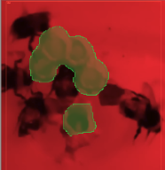

# UNet-plus-plus-with-PyTorch

  

  

This repository contains implementation of UNet++ trained on a closed dataset for the segmentation of bumblebees urns (open and closed).
The weights of the trained model are available at this link : https://huggingface.co/Le-Kral/BumblebeeUrnsUnetplusplus.